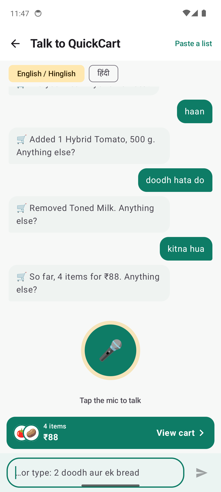
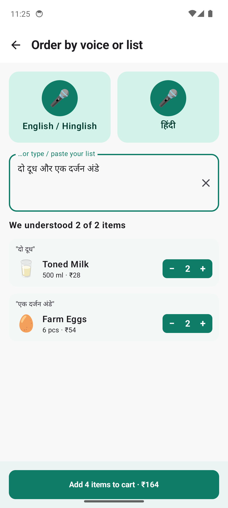
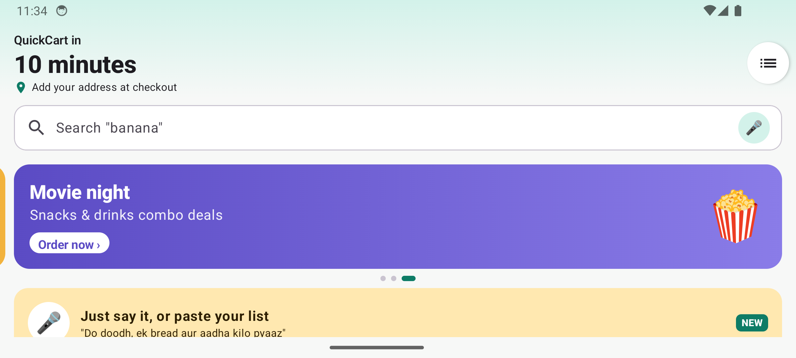

# QuickCart: quick-commerce Android app

A grocery-delivery app built with **Kotlin, Jetpack Compose, MVVM, Hilt, Room, Retrofit, Coroutines/Flow,
WorkManager and WebSockets**. It focuses on three things: the app keeps working on a bad network
(**offline-first**), **live order tracking**, and **voice ordering in Hinglish and Hindi**.

<p>
  
  
</p>


**Download:** see the latest APK under [Releases](https://github.com/irohitsharma21/QuickCart/releases). It runs on any Android 8+ phone with no server needed.

## Features
- **✨ Gemini AI mode**: the voice agent can run on **Gemini Live** (`gemini-3.1-flash-live-preview`) over a WebSocket
  straight from the phone, with no backend. Mic → 16 kHz PCM → Gemini → 24 kHz voice back, barge-in, live transcripts.
  The cart changes only through **validated function calls** (`add_to_cart`, `remove_from_cart`, `get_cart`, `place_order`).
  It falls back to the on-device agent when offline. Needs `GEMINI_API_KEY` in `local.properties`. Public APKs are built
  without it (`-Pquickcart.publicBuild=true`).
- **🗣️ Voice ordering agent ("Talk to QuickCart")**: a spoken conversation. *"ek kilo doodh"* → *"Added 2 Toned Milk,
  500 ml each. Anything else?"* It handles add / remove / "kitna hua?", and *"that's it"* / *"order all four"* → it confirms total, payment and address,
  then **places the order** on "yes" (it understands many forms of yes/no, and "no" always wins). Did-you-mean confirmations;
  English, Hinglish and Hindi. Android `SpeechRecognizer` + `TextToSpeech` with half-duplex turn-taking around a pure-Kotlin,
  unit-tested dialogue "brain" (`VoiceOrderAgent`). No backend needed.
- **🎤 Voice / list ordering**: say or paste *"do doodh, ek bread aur aadha kilo pyaaz"* or *"दो दूध और एक दर्जन अंडे"*.
  The system speech recognizer (en-IN / hi-IN) feeds an **on-device Hinglish/Hindi parser** (number words, units → packs,
  aliases, Levenshtein fuzzy matching, confidence thresholds). You get a review list, then one tap adds it all to the cart.
- **🧠 "Running low?"**: on-device reorder prediction from the user's own purchase intervals, with a "buy again" fallback for cold start.
- Quick-commerce UI: ETA header, sticky search with rotating hint, offers carousel, category tiles, product rows,
  sidebar category browser, product bottom sheet, recent and trending searches, savings and free-delivery progress,
  cart suggestions, delivery-partner tip, animated rider route map.
- **Room migration v1 → v2**, verified by `MigrationTest` against the exported schemas.
- Catalog with category chips and **debounced search**, served from Room, so it works offline.
- Cart stored in Room. It survives app restarts and having no network, with a per-item limit and an atomic quantity update.
- Bill with a free-delivery threshold. Money is stored as `Long` paise.
- **Checkout works offline**: the order is saved locally (`PENDING_SYNC`), and **WorkManager** sends it when the
  network returns. A client-generated **idempotency key** means retries never create duplicate orders.
- **Live tracking over a WebSocket**: `callbackFlow`-wrapped OkHttp socket, **lifecycle-aware** (the socket closes
  when the app is in the background and survives rotation), **exponential backoff with jitter** on reconnect, and
  the status never moves backwards on out-of-order messages.
- Order history and per-order tracking screen.

## Architecture
```
Compose UI ── collectAsStateWithLifecycle ──▶ ViewModel (StateFlow<UiState>)
                                                  │
                                             Repositories
                         ┌────────────────────────┼─────────────────────────┐
                    Room (source of truth)   Retrofit (REST)        OkHttp WebSocket
                         ▲                        │                         │
                         └──── network results are written into Room ◀──────┘
WorkManager (OrderSyncWorker) sends offline orders • Hilt wires everything
```
The UI only observes Room. The network only writes into Room.

| Package | Contents |
|---|---|
| `domain` | Plain-Kotlin models, `PricingRules`, `ReorderPredictor`, `smartlist/` (Hinglish parser) |
| `data/local` | Room entities, DAOs, database |
| `data/remote` | Retrofit API, DTOs, and `fake/` (in-app backend) |
| `data/realtime` | WebSocket client (`OkHttpOrderTrackingSocket`), fake socket, `Backoff` |
| `data/repository` | Catalog, Cart and Order repositories |
| `data/sync` | WorkManager scheduler + `OrderSyncWorker` |
| `di` | Hilt modules |
| `ui` | One package per screen (Screen + ViewModel), shared components, type-safe navigation |

## Backend
By default the app runs against an **in-app fake backend**: an OkHttp interceptor that answers
`GET /catalog` and `POST /orders`, plus a simulated socket. That means it runs on any device with no setup.
Retrofit, serialization and error handling still run for real, and the fake respects airplane mode.

There's also a real **FastAPI** server with the same API and a real WebSocket in [`server/`](server/main.py):
```bash
cd server && uv run --no-project --with fastapi --with "uvicorn[standard]" uvicorn main:app --host 0.0.0.0 --port 8000
./gradlew installDebug -Pquickcart.realBackend=true     # emulator reaches the host at 10.0.2.2
```

## Build and test
Requires JDK 17 and the Android SDK (or just open the project in Android Studio).
```bash
./gradlew assembleDebug          # APK in app/build/outputs/apk/debug/
./gradlew testDebugUnitTest      # 64 unit tests (voice agent, parser, predictor, migration, Room, MockWebServer, ViewModels)
cd server && uv run --no-project --with fastapi --with httpx --with pytest pytest -q   # 4 server tests
```

## Demo: offline order, then live tracking
1. Add items, then turn on airplane mode. The catalog, search and cart keep working.
2. Place the order. Tracking shows "Waiting for network".
3. Turn airplane mode off. WorkManager syncs it, the socket connects, and the status moves through
   Placed → Packed → On the way → Delivered (about 65 s in the demo timeline).

## Not included (on purpose)
Login, real payments, product images (emoji instead), a real map SDK, Paging, and modularisation.
The parser is rule-based on purpose (offline, free, testable). An LLM fallback for items it can't match is the planned next step.
